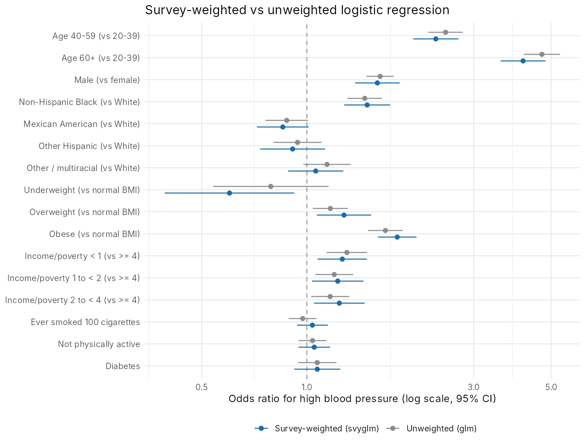

# High Blood Pressure in US Adults: Why Survey Weights Matter (NHANES 2009–2012)

NHANES is not a simple random sample. It uses a multistage, stratified, clustered design, and it deliberately oversamples some groups: older adults, Black and Hispanic Americans, and low-income people. If the data are analyzed as if every person counted equally, prevalence estimates are biased and standard errors are too small.

This project estimates the prevalence of high blood pressure in US adults and its risk factors. Every result is shown two ways, **with** and **without** the survey design, so the effect of weighting is easy to see.

## Questions
1. What share of US adults had high blood pressure in 2009–2012, and how does it differ by age, sex, race/ethnicity, and income?
2. How much do the answers change if the survey weights and design are ignored?
3. Which factors are linked to high blood pressure in a survey-weighted logistic regression?

## Data
`NHANESraw` from the R `NHANES` package. It contains the public NHANES 2009–10 and 2011–12 data released by CDC/NCHS, with the original exam weights (`WTMEC2YR`), strata (`SDMVSTRA`), and primary sampling units (`SDMVPSU`).

- **Population:** adults aged 20 and older who were examined at the mobile exam center and had a blood pressure reading (n = 10,852)
- **Outcome:** measured high blood pressure, average systolic ≥ 130 or diastolic ≥ 80 mmHg (2017 ACC/AHA threshold). A sensitivity analysis uses ≥ 140/90.
- **Regression sample:** 9,735 adults with complete covariate data

## Methods
- **Weights:** 4-year exam weight = `WTMEC2YR / 2`, following NCHS guidance for combining two cycles
- **Design:** `svydesign(ids = ~SDMVPSU, strata = ~SDMVSTRA, weights = ~WTMEC4YR, nest = TRUE)` with Taylor-series linearization for variances
- **Subpopulation analysis done correctly:** the design is built on the full file, then `subset()` is applied to the design. Subsetting the data first would drop PSUs and give wrong standard errors.
- **Estimates:** `svymean` and `svyby` for prevalence, with design effects
- **Regression:** `svyglm` with a quasibinomial family, compared with an ordinary unweighted `glm`
- **Tests:** design-based Wald tests (`regTermTest`) for groups of terms

## Results

### 1. The sample does not look like the population

| | Sample % | Weighted population % |
|---|---:|---:|
| Age 60+ | 32.7 | 25.5 |
| Non-Hispanic White | 43.0 | 67.6 |
| Non-Hispanic Black | 21.8 | 11.3 |
| Mexican American | 14.4 | 8.2 |
| Income below poverty line | 23.4 | 15.8 |
| Income ≥ 4 times poverty line | 24.9 | 35.6 |

The oversampled groups (older, Black, Hispanic, low-income) are also the groups with more high blood pressure. So an unweighted analysis overstates prevalence.

### 2. Ignoring the design gives a biased estimate and a falsely narrow CI

| Approach | Prevalence | SE | 95% CI |
|---|---:|---:|---|
| Unweighted (treats data as a simple random sample) | 38.2% | 0.47 | 37.3 to 39.1 |
| Weighted, ignoring strata and PSUs | 35.0% | 0.60 | 33.8 to 36.2 |
| **Weighted, full complex design** | **35.0%** | **0.92** | **33.2 to 36.8** |

- Weighting moves the estimate from 38.2% to 35.0%. The unweighted CI does not even include the correct value.
- Weights alone fix the estimate but not the uncertainty. With strata and PSUs included, the standard error is about twice the simple-random-sample value (design effect = 4.0).
- With the older ≥ 140/90 threshold, weighted prevalence is 15.0%.


The unweighted estimate is too high in **every** subgroup. Even inside one age group, the sample still has more Black, Hispanic, and low-income adults than the population does. Black adults have the highest prevalence (42.9%, 95% CI 39.6 to 46.1). Design effects for subgroups range from 1.4 to 3.4.

### 3. Survey-weighted logistic regression



| Predictor | Survey-weighted OR (95% CI) | Unweighted OR (95% CI) |
|---|---|---|
| Age 60+ (vs 20–39) | 4.15 (3.58, 4.81) | 4.70 (4.17, 5.30) |
| Male (vs female) | 1.59 (1.37, 1.84) | 1.62 (1.48, 1.77) |
| Non-Hispanic Black (vs White) | 1.49 (1.28, 1.73) | 1.46 (1.31, 1.64) |
| Obese (vs normal BMI) | 1.81 (1.60, 2.06) | 1.68 (1.50, 1.88) |
| Underweight (vs normal BMI) | 0.60 (0.39, 0.92) | 0.79 (0.54, 1.15) |
| Income below poverty (vs ≥ 4) | 1.26 (1.07, 1.49) | 1.30 (1.14, 1.49) |

- Age, male sex, Black race, obesity, and lower income are all linked to higher odds of high blood pressure.
- Some odds ratios change noticeably with weighting. The age 60+ OR falls from 4.70 to 4.15. The underweight OR is significant only in the weighted model.
- Design-based standard errors are larger for every coefficient, a median of 1.23 times the `glm` standard errors (up to 1.63 for sex). The unweighted model is overconfident.
- Joint Wald tests: age (p < 0.001), race/ethnicity (p < 0.001), BMI (p < 0.001), income (p = 0.047).

## Limitations
- High blood pressure here is **measured** blood pressure only. The data have no information on blood pressure medication, so people whose hypertension is controlled by treatment count as "not high". This may partly explain why diabetes shows almost no association, since many people with diabetes are already treated for blood pressure.
- The data are cross-sectional, so the associations are not causal.
- Complete-case analysis. Multiple imputation would be a natural next step.

## How to run
Requires R (4.1 or later).

```r
install.packages(c("NHANES", "survey", "ggplot2"))
```

```bash
Rscript R/analysis.R
```

Results are written to `output/` in a few seconds.

## Repository structure
```
nhanes-survey-hypertension/
├── R/analysis.R      # design setup, weighted estimates, svyglm
├── output/
│   ├── figures/
│   └── tables/
└── README.md
```

## References
- Centers for Disease Control and Prevention, National Center for Health Statistics. *NHANES Survey Methods and Analytic Guidelines*.
- Lumley, T. (2010). *Complex Surveys: A Guide to Analysis Using R*. Wiley.
- Lumley, T. (2004). Analysis of complex survey samples. *Journal of Statistical Software*, 9(8), 1–19.
- Whelton, P. K., et al. (2018). 2017 ACC/AHA guideline for the prevention, detection, evaluation, and management of high blood pressure in adults. *Hypertension*, 71, e13–e115.
- Pruim, R. (2015). NHANES: Data from the US National Health and Nutrition Examination Study. R package.

## Author
Tahsina Fariha Ohi, MS Statistics, Ball State University
