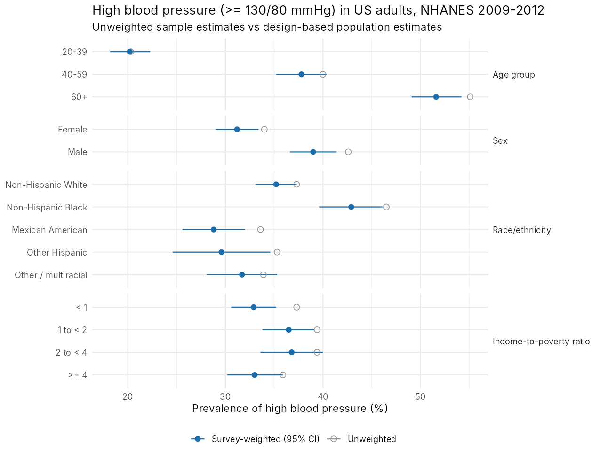

# High Blood Pressure in US Adults: Why Survey Weights Matter (NHANES 2009–2012)

NHANES uses a complex survey design and oversamples some groups, like older adults, Black and Hispanic Americans, and low-income people. If we analyze it like a simple random sample, the prevalence estimates are biased and the standard errors are too small. In this project I estimate the prevalence of high blood pressure **with** and **without** the survey design to show the difference.

## Questions

1. What share of US adults had high blood pressure in 2009–2012?
2. How much do the results change if the survey design is ignored?
3. Which factors are linked to high blood pressure?

## Data

`NHANESraw` from the R `NHANES` package (NHANES 2009–10 and 2011–12), with the original exam weights, strata, and PSUs.

- Adults aged 20+ with a blood pressure reading (n = 10,852)
- High blood pressure: systolic ≥ 130 or diastolic ≥ 80 mmHg (2017 ACC/AHA)
- Regression sample: 9,735 adults with complete data

## Methods

- 4-year exam weight = `WTMEC2YR / 2`
- `svydesign()` with strata and PSUs; subpopulations taken with `subset()` on the design, not on the data
- `svymean`, `svyby` for prevalence; `svyglm` (quasibinomial) for regression, compared with unweighted `glm`

## Results

| Approach | Prevalence | SE | 95% CI |
|---|---:|---:|---|
| Unweighted | 38.2% | 0.47 | 37.3 to 39.1 |
| Weighted, ignoring strata and PSUs | 35.0% | 0.60 | 33.8 to 36.2 |
| **Weighted, full design** | **35.0%** | **0.92** | **33.2 to 36.8** |

- The unweighted estimate is too high, and its CI does not include the correct value.
- Weights fix the estimate, but strata and PSUs are needed for the correct SE (design effect = 4.0).



| Predictor | Survey-weighted OR (95% CI) | Unweighted OR (95% CI) |
|---|---|---|
| Age 60+ (vs 20–39) | 4.15 (3.58, 4.81) | 4.70 (4.17, 5.30) |
| Male (vs female) | 1.59 (1.37, 1.84) | 1.62 (1.48, 1.77) |
| Non-Hispanic Black (vs White) | 1.49 (1.28, 1.73) | 1.46 (1.31, 1.64) |
| Obese (vs normal BMI) | 1.81 (1.60, 2.06) | 1.68 (1.50, 1.88) |
| Income below poverty (vs ≥ 4) | 1.26 (1.07, 1.49) | 1.30 (1.14, 1.49) |

- Older age, male sex, Black race, obesity, and lower income are linked to higher odds of high blood pressure.
- Design-based standard errors are larger for every coefficient (median 1.23 times the `glm` SEs).

## Limitations

- Only measured blood pressure is used. There is no data on blood pressure medication, so treated people may count as "not high".
- Cross-sectional data, so the results are not causal.
- Complete-case analysis; multiple imputation could be a next step.

## How to run

Needs R 4.1+ with `NHANES`, `survey`, and `ggplot2`.

```bash
Rscript R/analysis.R
```

Results are saved in `output/`.

## References

- Lumley, T. (2010). *Complex Surveys: A Guide to Analysis Using R*. Wiley.
- CDC/NCHS. *NHANES Survey Methods and Analytic Guidelines*.

## Author

Tahsina Fariha Ohi, MS Statistics, Ball State University
